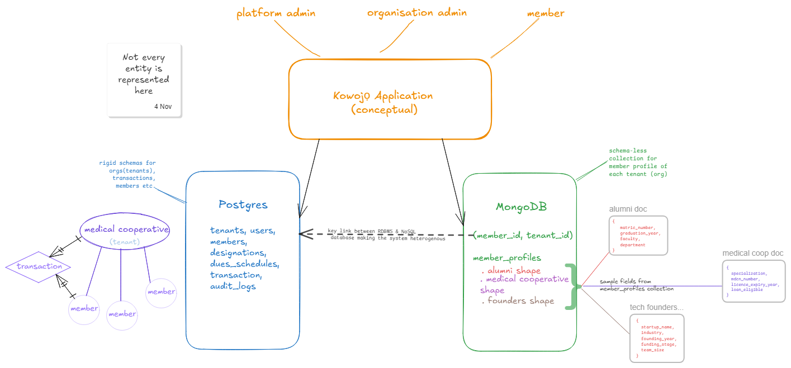

# Kowojọ — Advanced Database Systems Portfolio

**Course:** MIT 8103 Advanced Database Systems
**Institution:** MIVA Open University School of Post Graduate Studies
**Academic Session:** 2026/2027 | First Semester Continuous Assessment
**Matric Number:** 2026/A/MIT/0905
**Student:** Israel Oyeboade

---

## Selected Case Study / Organisation

**Organisation Name:** Kowojọ

**Nature of the System:**
Kowojọ is a multi-tenant dues management platform designed for organisations such as alumni associations, cooperatives, professional bodies, student unions, and similar groups, to manage their members' dues payments in a structured, centralised way. Rather than each organisation setting up its own fragmented means of collecting dues (hardcopy ledger notes, spreadsheets, bank transfers, WhatsApp coordination), Kowojọ provides a unified platform where organisations onboard as tenants, members register under their organisation, and dues are collected and tracked systematically.

**Users of the Database:**

- **Platform administrators**: oversee all tenants and platform health
- **Organisation administrators**: manage their organisation's members, dues schedules, and payment records
- **Members**: register under an organisation, pay dues, and view their membership and payment history

**Major Data to be Stored:**

- Tenant (organisation) records
- Member profiles and authentication data
- Dues schedules and payment plans
- Payment and transaction records
- Audit logs
- Organisation-specific member attributes (variable schema per tenant)

---

## Architecture Overview

Kowojọ uses a heterogenous/polyglot persistence approach:

- **PostgreSQL** serves as the primary relational database, handling all structured, transactional, and financially critical data including tenants, members, dues, payments, and audit logs.
- **MongoDB** handles organisation-specific member profile data, where the schema varies per tenant. A medical association may require license number and specialty; a student union may require matric number, department, and level.
The RDBMS (Postgres) is connected to MongoDB through the `member_id` and `tenant_id` keys. Every document contains them.

Multi-tenancy is implemented using a shared schema with `tenant_id` column strategy i.e all tenant data lives in shared tables, scoped by a `tenant_id` foreign key.



### [Entity Relationship Diagram](portfolio-1-database-design/kowojo_db%20-%20ERD.png)

---

## Tools and Technologies

| Layer | Technology |
| --- | --- |
| Relational Database | PostgreSQL 16.9 |
| NoSQL Database | MongoDB 9.0 |
| Query & Schema Tools | psql, SQLALchemy 2.0, DBeaver |
| NoSQL Client | MongoDB Compass, mongosh |
| Version Control | Git + GitHub |
| Diagramming | excalidraw.com, DBeaver |

---

## Portfolio Map

| Portfolio | Focus | Entry files | Evidence |
| --- | --- | --- | --- |
| [1: Database Design](portfolio-1-database-design/) | Relational schema, keys, constraints, normalisation, RBAC, multi-tenancy | `schema.sql`, `teardown.sql`, `kowojo_db/` | ERD, README |
| [2: Query Optimisation](portfolio-2-query-optimisation/) | 8 SQL queries, `EXPLAIN ANALYZE`, composite indexes for Q4 and Q6 | `seed.sql`, `queries.sql`, `optimisation.sql` | `screenshots/` |
| [3: Transactions & Concurrency](portfolio-3-transaction-concurrency/) | Commit, rollback, ACID, isolation levels, `SELECT FOR UPDATE` | `transactions.sql`, `concurrency.sql` | `screenshots/` |
| [4: NoSQL](portfolio-4-nosql/) | MongoDB member profiles: 12 documents, 3 tenant-specific shapes, 3 queries | `seed.js`, `queries.js` | `screenshots/` |
| [5: Distributed & Cloud](portfolio-5-distributed-cloud/) | LIST partitioning by `tenant_id` (imitating sharding), CAP, replication, Neon and Atlas (deployment) design | `partition.sql` | `screenshots/` |

## How to Reproduce

**Requirements:** PostgreSQL 15+, MongoDB with `mongosh`, DBeaver (or `psql`).

Run the steps in this order. Portfolio-5 (P5) depends on Portfolio-3 (P3).

1. **Create the database** `kowojo_db` in PostgreSQL.
2. **P1:** run `portfolio-1-database-design/schema.sql`.
3. **P2:** run `portfolio-2-query-optimisation/seed.sql`, then `queries.sql`, then `optimisation.sql`.
4. **P3:** run `portfolio-3-transaction-concurrency/transactions.sql` (S1, S2, S3 in order), then `concurrency.sql`.
5. **P5:** run `portfolio-5-distributed-cloud/partition.sql`.
6. **P4:** run

```bash
cd portfolio-4-nosql
mongosh --file seed.js
mongosh kowojo
```

   Then run each query block from `queries.js`.

### Expected results

| Step | Result |
| --- | --- |
| After `seed.sql` | 28 rows in `transactions` |
| After `transactions.sql` | 30 rows in `transactions` |
| `partition.sql` | Partitions: OSAA 11, IFEM 10, LTFC 9 (total 30) |
| `seed.js` | 12 documents in `kowojo.member_profiles` |
| `queries.js` | Q1: 3 documents, Q2: 2 documents, Q3: 3 summary documents |

### Reset

`transactions.sql` is not re-runnable because `payment_reference` is UNIQUE. To reset, run `portfolio-1-database-design/teardown.sql`, then `portfolio-1-database-design/schema.sql`, then `portfolio-2-query-optimisation/seed.sql`, and repeat the steps above.

## Repository Structure

```
advanced-database-portfolio/
├── README.md
├── .gitignore
├── portfolio-1-database-design/
│   ├── README.md
│   ├── schema.sql              # DDL: enums, tables, constraints, indexes
│   ├── teardown.sql            # drops all objects
│   ├── kowojo_db - ERD.png
│   ├── requirements.txt
│   ├── .env.example
│   └── kowojo_db/              # SQLAlchemy models and DB setup
│       ├── base.py
│       ├── database.py
│       ├── init_db.py
│       └── models/             # tenant, user, designation, member,
│                               # dues_schedule, transaction, audit_log
├── portfolio-2-query-optimisation/
│   ├── README.md
│   ├── seed.sql                # sample data (3 tenants, 24 members, 28 transactions)
│   ├── queries.sql             # 8 queries
│   ├── optimisation.sql        # EXPLAIN ANALYZE before/after indexing
│   └── screenshots/
├── portfolio-3-transaction-concurrency/
│   ├── README.md
│   ├── transactions.sql        # commit, rollback, savepoint scenarios
│   ├── concurrency.sql         # isolation levels, SELECT FOR UPDATE
│   └── screenshots/
├── portfolio-4-nosql/
│   ├── README.md
│   ├── seed.js                 # MongoDB member profiles (12 documents)
│   ├── queries.js              # 3 queries
│   └── screenshots/
└── portfolio-5-distributed-cloud/
    ├── README.md
    ├── partition.sql           # LIST partitioning by tenant_id (imitating sharding)
    └── screenshots/
```

## Known Limitations

- **Small dataset:** with 28 seed transactions, PostgreSQL chose sequential scans before and after indexing. The timing differences in Portfolio 2 are inconclusive and are not evidence of index use.
- **Tenant consistency:** `transactions.tenant_id` is denormalised, and the schema does not enforce that it matches the member's tenant (no composite foreign key).
- **Redundant indexes:** four explicit indexes duplicate the indexes PostgreSQL already creates for UNIQUE constraints.
- **MongoDB:** profiles exist for 12 of the 24 members (4 per tenant). The link to PostgreSQL is by shared UUIDs only, with no cross-database integrity checks. Only `member_id` has an index.
- **Cloud:** Neon and MongoDB Atlas are design choices only; nothing is deployed. The CAP classifications are simplified.

## AI Use Declaration

**Tool:** Claude via claude.ai.

**Used for:**

- Planning each portfolio.
- Drafting SQL and mongosh scripts for Portfolios 1, 2, 3, 4 and 5, plus the seed data.
- First drafts of README text.
- Reviewing the repository for errors and inconsistencies.

**Reviewed, tested and corrected by me:**

- I ran every script in psql, DBeaver and mongosh. Failures exposed wrong column names and enum values in the first P3 scripts, and I corrected them against my `schema.sql`.
- I found that the first MongoDB seed did not match my Portfolio 2 data. It was regenerated with the real tenant and member IDs.
- An AI-assisted review flagged that the first P3 payment scenario charged an already-paid member. I fixed the scripts and re-ran them.
- I edited and trimmed the generated scripts and READMEs, and corrected README claims that did not match the scripts or the results I observed.
- I took the screenshots from my own runs.

I am responsible for the accuracy and originality of this submission and can explain all of it

---
